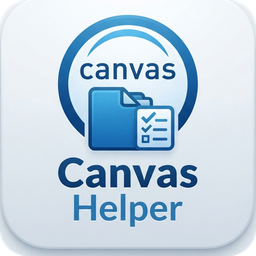

# CanvasHelper · Canvas 课程同步与学习辅助

[](https://github.com/Botherain/CanvasHelper/actions/workflows/ci.yml)
[](LICENSE)
[](pyproject.toml)

<p align="center">
  
</p>

连接你学校的 Canvas（LMS），把课程内容按既有目录规则归档到本地，把各课截止时间变成桌面上的待办。适用于**任何使用 Canvas 的院校**，登录走学校自己的 SSO，不绑定某一所学校。

> 本工具面向**个人学习用途**，请勿用于批量抓取或再分发课程内容。与 Instructure / Canvas 及你所在院校无任何关联，详见 [免责声明](#免责声明)。

## 目录

- [项目介绍](#项目介绍) — 它解决什么问题、功能一览、跨院校通用、安全与隐私
- [快速开始](#快速开始) — 从零到可用的五步
- [详细使用教程](#详细使用教程) — 界面导览、归档规则、接口降级、清理缓存、检查更新、命令行、设置项、开发者参考
- [相关项目：DeskBox](#相关项目deskbox) — DeskBox 是什么、两者的关系、待办写入策略、待办排序与课程颜色
- [常见问题与解答](#常见问题与解答) — 学校不在清单、时区偏差、登录过期、重复待办、磁盘占用等
- [免责声明](#免责声明)

## 项目介绍

### 它能做什么

一句话：**替你把 Canvas 上的课件按既有目录规则归档到本地，把各课截止时间变成桌面上的待办**。它接手四件日常麻烦事：

| 以前的做法 | 用本工具之后 |
| --- | --- |
| 一门课点进 Files 下载讲义 / 作业，再手动分文件夹 | 勾选课程 -> **开始同步**，自动归档到 `1.Lecture session` … `6.Others`，讲义按章分文件夹、压缩包自动解压，本地已有的跳过 |
| 截止时间散在各课作业页 / 公告里，容易漏 | 同步时统一写进 **DeskBox 待办**（附 Canvas 原链接），或导出 `.ics` 进 Windows / 手机日历 |
| 想知道这周该干什么、考了多少分 | 通知 / 公告、成绩聚合在一页看；每周生成 `本周摘要-YYYY-Wnn.md` |
| 每天手动重复一遍 | 注册计划任务，每天后台同步一次（无窗口） |

### 功能一览

| 模块 | 说明 |
| --- | --- |
| 课程同步 | 自动识别在读课程 -> 勾选 -> 拉取模块 / 文件 / 页面 -> 归档到 `1.Lecture session` / `2.Tutorial session` / `3.Assignments` / `4.Projects` / `5.Books\|Useful links` / `6.Others` |
| 讨论区内容 | 帖子正文 / 回帖里的 **Colab / GitHub 链接**转 raw 直链下载（教程笔记本不再手动另存），帖子本身存 HTML 快照 |
| 待办写入 | 解析 Canvas 截止时间 -> **先写副本 `todo.json.new`** -> 关闭 DeskBox -> 原子替换 -> 立即重启（停机约 1 秒），并附带 Canvas 原链接 |
| 通知聚合 | 各课公告 + Activity Stream，可直接跳转原页；**通知正文只在内存里，打开时现拉一次**，`state.json` 只留已读标记 |
| 截止日历 | 一键导出 `.ics`，可导入 Windows / 手机日历（含提前 1 天提醒） |
| 成绩追踪 | 读取 Canvas 已出分项目与当前总评分，回写每门课的 `GradeNeed.txt` |
| 每日同步 | Windows 计划任务每天定时后台同步（无窗口，用已保存的登录态） |
| 每周摘要 | 每周生成 `本周摘要-YYYY-Wnn.md` 到各课程文件夹 |
| 缓存清理 | **一键清理**下载状态、已读标记、导出日历、日志、浏览器缓存（默认不动登录态） |
| 完成去重 | 已完成的作业**不会**再次写入；同名同截止的重复条目在写入时自动清理 |
| 版本更新 | 自动查 GitHub Releases：顶栏提示新版本、弹窗展示落后期间**全部**版本的更新公告，exe 版可一键下载替换并重启；离线静默跳过 |

### 跨院校通用

Canvas 在全球有数千所院校在用，站点地址五花八门（`canvas.<校名>.edu`、`<缩写>.instructure.com`、`canvas.<校名>.ac.uk` ……）。本工具在三处最容易因校而异的地方做了配置化，其余差异由代码自动适配。

**1. 站点地址与院校清单**

首次启动会弹出**「选择你的学校」**窗口：内置 126 所已核实的院校可按校名 / 域名搜索、按地区筛选，也可以直接手填地址。选完立即进入该校的 Canvas 登录页。

清单里的每条地址都经程序核实——请求 `<地址>/api/v1/users/self/profile`，返回 `401` 且响应体是含「未认证」语义的 JSON 才算 Canvas 实例（非 Canvas 站点返回 `404` 或 HTML 页面）。清单还会从 **Canvas 官方院校目录**（Instructure 公开接口）在线更新，合并去重后缓存在本机，离线时自动降级。详见 [院校清单](#院校清单与在线更新)。

**2. 时区**

影响截止时间的显示与「是否已过期」的判定。配置项 `timezone` 留空时**跟随本机系统时区**（多数人这就是对的），要固定就填 IANA 名（`Asia/Hong_Kong`、`America/New_York`、`Asia/Shanghai` 等）。填错会让待办里的截止时刻整体偏几个小时。

**3. 课程代码**

自动识别「字母前缀 + 数字」，并剥掉开头的学期前缀。课程代码同时用于**匹配本地课程文件夹**，因此换学校不会另建重复目录。

| Canvas 的 `course_code` | 本工具认出的课程代码 |
| --- | --- |
| `202609CS5187` | `CS5187` |
| `MATH 101` | `MATH101` |
| `ECON2201` | `ECON2201` |
| `BIO-220` | `BIO220` |
| `SD_GEN_SFTY_CS_MCS_2026`（多段码） | 整段保留，不拆 |

代码形态特殊的学校可在设置页写一条正则（`course_code_pattern`）：有捕获组取第一个非空捕获组，没有则取整个匹配。

**4. 已自动适配的 Canvas 差异**（无需配置，遇到即降级）

| 差异 | 本工具的做法 |
| --- | --- |
| 课程级 `/files` 接口 403 | 改从模块条目、作业描述、页面正文里挖文件 |
| `/courses/:id/pages` 列表 404 | 改用模块条目的 `page_url` 调 show 接口 |
| 模块条目不带 `content_details` | 逐个补查文件元信息 |
| 公告接口不存在 | 自动改用 `discussion_topics?only_announcements=true` |
| 文件被隐藏 / 锁定 | 跳过并记日志，不打扰你 |
| 课程代码带学期前缀 | 自动剥掉再匹配本地目录 |

### 安全与隐私

- **联网范围很窄**：只访问你在配置里填写的 Canvas 站点、完成登录所需的 SSO 域名（由学校登录流程决定，如 `sso.canvaslms.com`）、在线更新院校清单时的 Canvas 官方目录接口，以及检查 / 下载新版本时的 GitHub（`api.github.com` / `github.com`，只发 GET、不带本地数据；可用 `update.check_on_start=false` 关掉）。**不连任何其他第三方服务器**；无遥测、无统计、无任何数据上报。
- **数据只在本机**：配置、同步状态、日志、登录态全在 `%LOCALAPPDATA%\CanvasHelper\`（见 [数据目录](#数据目录)），课程文件落在你自己的课程根目录。这些目录都在仓库之外；`config.json` / `state.json` / `sync.log` 等可再生文件以及 `session.json` / `profile\` 还额外进了 `.gitignore`，双保险不会被提交。
- **登录态 = 凭据**：学校 Cookie 存在 `session.json` 与浏览器 `profile\` 目录，**不要发给别人、不要连同打包分享**；`canvas-helper clean --login` 可连登录态一起清掉。
- **日志不记凭据内容**：`sync.log` 只记录 cookie 条数与出错信息，不写 cookie / 密码的值；日志自动轮转（1 MB x 3 备份），不想留痕就用设置页「一键清理缓存」清掉。
- **通知正文不落盘**：通知内容只在内存里、打开时现拉一次，`state.json` 只留已读标记。
- **动 DeskBox 数据前先备份**：写 `todo.json` 前自动备份为 `todo.json.pre-canvas`，只增不删、不碰你手写的条目。
- **可审计**：本项目以 MIT 开源，代码就在本仓库，以上每条都能在源码里核对。

## 快速开始

### 前置条件

Windows 10 / 11、Python 3.9 以上。浏览器优先用系统自带的 Edge——Playwright 直接驱动它，**不用另下浏览器**；万一这台机器没有 Edge，设置页有「安装 Chromium」按钮（命令行等价：`python -m canvas_helper install-browser`），下载一次约 150 MB。

### 第一步：取得项目文件

```powershell
git clone https://github.com/Botherain/CanvasHelper.git
cd CanvasHelper
```

没有 git 也行：仓库页面 -> **Code -> Download ZIP**，解压后进入该目录。

### 第二步：安装依赖

```powershell
py -3 -m pip install -e .        # 没有 py 启动器就写 python -m pip install -e .
```

运行时依赖只有 `playwright` 与 `tzdata`，pip 会一并装好。要跑自检 / 静态检查再补一句 `py -3 -m pip install -e ".[dev]"`（pytest / ruff / mypy / Pillow）。

### 第三步：首次启动（选学校 + 登录）

```powershell
canvas-helper              # 安装后的命令行入口
# 或（在源码目录里）
python -m canvas_helper
# 或
.\启动Canvas助手.bat
```

**不需要手写任何配置**。首次启动会先弹出「选择你的学校」窗口，从清单里挑一所（或直接手填地址），随后弹出 Edge 完成学校 SSO / 2FA。之后长期免登录，掉线时会自动重新弹窗。

课程列表出现后会自动匹配本地文件夹并预勾选；这时建议**先点「预览归档方案」**（只读、不写盘）确认落点，再点「开始同步」。

### 第四步：桌面快捷方式（带图标、全程无控制台）

```powershell
powershell -NoProfile -ExecutionPolicy Bypass -File scripts\make_shortcut.ps1
```

生成的快捷方式显示名 `CanvasHelper`、挂上应用图标，直接以 `pythonw` 启动 GUI。`.bat` 本身无法承载图标，且双击时 Windows 必先给它一个控制台（约 0.2 秒黑框），所以快捷方式不走 `.bat`。

### 让它每天自动跑

**设置** 页勾选「启用每日自动同步」并点「保存设置」，之后每天后台同步一次（无窗口，用已保存的登录态）。计划任务在当前用户下运行，注销后不执行。

### 数据目录

首次运行会自动生成下列文件，全部位于 `%LOCALAPPDATA%\CanvasHelper\`，与安装位置解耦，换盘符、换机器、打包成 exe 都不受影响：

```
%LOCALAPPDATA%\CanvasHelper\
├─ config.json               配置（首次运行自动生成）
├─ state.json                同步状态（已下载文件、已读通知、已完成待办、更新公告已读/已跳过）
├─ sync.log                  日志（自动轮转，1 MB x 3 备份）
├─ schools_cache.json        院校清单的在线缓存
├─ update_cache.json         上次检查到的新版本与公告（可离线查看）
├─ updates\                  更新包下载 / 解压 / 替换脚本（可随时清掉）
├─ pending_todos.json        后台排队的待办
├─ canvas-deadlines.ics      导出的截止日历
├─ session.json              Canvas 登录 cookie
└─ profile\                  持久化浏览器 profile
```

从旧版本（数据放在源码目录）升级时会**自动搬一次**，原文件保留作备份。

## 详细使用教程

### 界面导览

**第一次上手，照着点六下**：

1. **选学校并登录** -> 首次启动弹出「选择你的学校」，选定后弹出 Edge，完成学校 SSO / 2FA。课程列表出现后会自动匹配本地文件夹并预勾选。
2. **确认课程根目录** -> 设置页看 `classes_root`（默认 `<用户目录>\CanvasCourses`），不是你的目录就点 **浏览…** 改。
3. **先预览再动手** -> 点 **预览归档方案**，只读地列出每个文件将落到哪个目录，**不写盘**。
4. **同步一次** -> 点 **开始同步**：下载 + 归档 + 写待办 + 更新成绩 + 导出日历。
5. **看截止与通知** -> **待办** 页可单独读取截止时间、写入 DeskBox、导出 `.ics`（含提前 1 天提醒）；**通知 / 公告**、**成绩** 在另外两个标签。
6. **交给它自动跑** -> 设置页勾选 **启用每日自动同步** -> 点 **保存设置**（同时注册计划任务）。

界面共五个标签：**课程同步**、**待办**、**通知 / 公告**、**成绩**、**设置**。顶栏常驻「选择院校」「打开 Canvas」「登录 / 刷新课程」三个按钮，以及登录状态（过期时会变成醒目的 `⚠ 已过期（时间），点击重新登录`，点它即可）。

### 课程同步与归档规则

判定优先级：**Canvas 文件夹路径 > 文件名 / 模块名 > 内容类型 > 根目录演示稿**。

- 关键词按「词边界 + 归一化」匹配：`_` `-` `/` 转空格、字母与数字之间断开，所以 `Assignment1` 能命中 assignment，而 `syllabus` 不会误判成 `lab`、`past_paper` 不会误判成 `paper`。
- 文件夹路径是最强信号（`course files/Lecture/Week3` -> 讲义，`course files/Tutorial/Week2` -> 习题课）；例外：文件夹只是泛泛的 `Week N`，而文件名明确写了作业 / 项目时，以文件名为准。
- 目标目录**镜像 Canvas 文件夹层级**，并复用本地既有目录名：`course files/Assignment1/CV_guideline/data/gallery` -> `3.Assignments/Assignment_1/CV_guideline/data/gallery`；`Tutorial` / `Tutorials` 这类本身就是分类词的首段不再多建一层。
- **讲义按章分组，不再平铺**：识别到章节号就归进子目录（`1.Lecture session/Lecture3/Lecture3a.pdf`），编号来源优先级为 **Canvas 文件夹里的编号 > 模块名 / 文件名的「关键字 + 编号」（`Lecture3a`、`Week 2`）> 文件名纯数字开头（`1.Review of Algorithms.pptx`、`0.Introduction.pptx`）**；目录名跟着本地既有样式走（已有 `Lecture1` 就一律 `Lecture{n}`）。识别不到编号的散件（`data.zip`、`jupyter-shortcuts.pdf`）留在根目录平铺，`CS0003 - Lecture slides.pdf` 这类也不会被「名字里第一个数字」误分成 `Lecture54`。
- 分类目录以磁盘上已存在的 `N.` 目录为准，例如 `5.Useful links` 与 `5.Books` 二选一。
- **本地已有内容不重复下载**：按**归一化文件名 + 大小**判断，Canvas 的 `1. Review of Algorithms.pptx` 能对上本地 `1.Review of Algorithms.pptx`、`0.Introduction.pptx` 能对上 `Introduction.pptx`；纯数字名（`0.jpg` / `1.npy`）不会被误判。
- **只增不删**：同名同大小跳过，同名不同大小自动加 `(1)` 后缀。
- **整理已有的散件**：设置页 **整理讲义目录** 或 `python -m canvas_helper tidy` 先列出「哪些文件移到哪个章节目录」的方案，确认后才移动——只移动不删除，重名自动加 `(1)`，`state.json` 里的路径跟着回写。

### 文件发现与接口降级

不同课程在 Canvas 里的挂载方式差得很远，**任何单一接口都会漏**。同步时按序采五条来源，任一条失败（403 / 404 / 限流）自动降级，不影响其余：

1. **模块条目**——含模块内的 Page 正文；
2. **作业描述**——截止时间与作业附件的唯一可靠来源；
3. **公告 / 讨论正文**——含 Colab / GitHub 链接抽取；
4. **课程级文件索引** `/api/v1/courses/:id/files`。

其中第 1 条里藏着最麻烦的一种课。以 `CS0003` / `CS0005` 为例，实测：

| 通道 | 结果 |
| --- | --- |
| 课程级 `/files` | **403** |
| 逐个文件夹列 `/folders/:id/files` | **403**（46/46 个文件夹全被挡） |
| 模块里的 File 型条目 | **0 条** |
| 模块条目的 `content_details.body` | **空**（14/14 个 Page 连 `body` 键都没有） |
| 页面 show `/courses/:id/pages/:page_url` | **200** |

也就是说课件全挂在模块内的 **Page 正文**里，而模块条目恰好带着 `page_url`——用它去调页面 show 接口是唯一能挖到文件的路。这条路走通后：

| 课程 | 改造前 | 改造后 |
| --- | --- | --- |
| `CS0003` | 21 个 | **58 个**（+176%） |
| `CS0005` | 9 个 | **41 个**（+356%） |
| `CS0001` | 2061 个 | 2061 个（无回归） |

补充策略：

- 页面 show 接口也失败时，**退回抓 `html_url` 的源码**再正则抽链接；
- 单文件 `/files/{id}` 即使在索引 403 时也通常可读，拿它补齐 `folder_id`，于是 `folder_path` 100% 拿到，归档分类不会因为索引被挡而退化成全进 `6.Others`；
- 死链（`/files/{id}` 返回 404）与 hidden / 锁定文件被容错跳过，不中断整轮收集；
- 同一文件被多条来源命中时按 `file_id` 去重，不会重复下载。

这套退化路径有离线回归测试锁着（`tests/test_canvas_api.py`），改坏会红。

### 讨论区内容与压缩包解压

**讨论区里的链接文件**（设置页「保存讨论区内容」可关）：Colab 教程笔记本直接下载——`colab.research.google.com/drive/{文档id}`（Drive 型，公开分享可匿名下载，用帖子标题命名）与 `colab.research.google.com/github/.../blob/...`、`github.com/.../blob/...`（GitHub 型，转 raw 直链）都支持。列表接口不给正文时自动补 show 接口；正文里没链接时才去翻回帖。帖子本身另存一份 HTML 快照（含正文与「打开原文」链接），私有链接下不了时也不丢；公告只扫链接不快照。

**压缩包自动解压**（设置页可关）：内容包（含 `.ipynb` / `.py` / `.pdf` …）解压到就近目录（`Lecture3\Lecture3.zip` 解进 `Lecture3\`），**数据包原样保留**——包名命中 `data` / `dataset` / `train` …，或忽略 `README*` 后包内没有任何讲义 / 代码文件（`.sh` 装机脚本与 `.txt` 不算内容信号）的，一律不解压（`data.zip` 这类正是 ipynb 要读的原始数据）。判定在本机 35 个真实课程压缩包上标定过：17 个讲义 / 作业包全解、10 个数据包全留。解压逐条手工写盘、拒绝 `..` 越界（zip-slip）、跳过 `__MACOSX` / `._*` 垃圾、带体积上限；判定结果记进 `state`，重复同步不会解第二遍，压缩包本身永远保留。

### 待办、通知、成绩与日历

- **待办**：同步时把未截止的作业 / 测验 / 项目写进 DeskBox，附 Canvas 原链接与提前提醒；写入策略见 [相关项目：DeskBox](#相关项目deskbox)。也可只导出 `.ics` 而不写 DeskBox。
- **通知 / 公告**：各课公告 + Activity Stream 聚合一页，按时间倒序，可点进原页。**正文只在内存里**，`state.json` 只留已读标记，因此换机器 / 清状态后会被重新标为未读。
- **成绩**：读取已出分项目与当前总评分，回写每门课目录下的 `GradeNeed.txt`（追加 / 刷新一段，不破坏你原有的笔记）。
- **日历**：导出 `canvas-deadlines.ics`，时间戳统一用 UTC，任何日历客户端都能正确显示；含提前 1 天提醒。
- **每周摘要**：生成 `本周摘要-YYYY-Wnn.md` 到各课程文件夹，含本周新增文件、最近公告、本周截止项与成绩。

### 一键清理缓存

**设置** 页的「一键清理缓存」按钮（或命令行 `clean`）。

| 项目 | 默认 | 说明 |
| --- | --- | --- |
| 下载状态 / 已读标记 | 勾 | 清 `state.json` 的下载记录与已读标记；下次同步重新核对，有本地内容识别兜底不会重复下载，通知会被重新标为未读 |
| 导出的 `.ics` | 勾 | 随时可重新导出 |
| 运行日志 | 勾 | 清空 `sync.log`（句柄保持打开，继续记录新日志），并一并删除轮转出的 `.1` / `.2` / `.3` |
| 浏览器缓存 | 勾 | `Default/Cache`、`ShaderCache` 等 14 个缓存目录，**不含 Cookie，登录态仍然有效** |
| 后台排队待办 | 不勾 | 会丢掉还没写入 DeskBox 的截止提醒，需要手动勾选 |
| DeskBox 重复待办 | 不勾 | 删除重复条目并重启 DeskBox，需要手动勾选 |
| 已下载的更新包 | 勾 | `updates/` 里下载的 zip 与解压结果（几十上百 MB），需要时重新下载 |
| 登录态 | 不勾 | `session.json` + 浏览器 Cookie，勾了就得重新登录 |

浏览器缓存按**目录名**匹配，`Cookies` / `Login Data` / `Local State` / `Local Storage` 等永远不在清理范围内（自检里有对应断言）。

### 检查更新与更新公告

程序会自己看 GitHub Releases 上有没有新版本，**发现新版就在顶栏挂一条提示**，点开是一份「这段时间新增了什么」的公告——不是一句干巴巴的「发现新版本」。

- **什么时候查**：打开 GUI 时后台查一次、每日后台同步顺手再查一次；两次真正联网之间至少隔 24 小时（`update.interval_hours`，设 0 表示每次启动都查）。也可随时手动点设置页「检查更新」（绕过节流）。
- **提示长什么样**：顶栏登录状态右侧出现 `⬆ 新版本 vX 可用，点此查看`（蓝色可点）。第一次发现时会自动弹公告窗，看过后只留横幅；点「跳过这个版本」则这个版本彻底不再提示（有更新的版本时还会出现）。
- **已是最新时也能看本版新功能**：设置页「查看更新公告」会展示**当前版本**的说明（缓存里就有，离线可看）；**升级后第一次启动会自动弹一次「已更新到 vX」**，只弹一次。
- **怎么更新**：1.2.x 及应用内更新上线之前的版本**需要手动覆盖一次**（下载 zip 解压覆盖安装目录，配置与登录态都在 `%LOCALAPPDATA%`，不受影响）；从 1.3.x 起，公告窗里点「立即下载并更新」即可自动完成：下载 → 校验 sha256 → 解压 → 关掉程序 → 覆盖安装目录 → 重新打开。源码 / wheel 用户 `git pull` 后 `pip install .`。
- **公告内容哪来的**：发版时 `.github/workflows/release.yml` 会把 `CHANGELOG.md` 对应版本的小节写成 Release 正文，所以公告 = CHANGELOG。**落后好几个版本时会一次列出所有中间版本**（新→旧，最多 10 个）。
- **一键更新（exe 版）**：公告窗里点「立即下载并更新」→ 下载 win64 zip（有 `sha256` 就校验）→ 解压到 `%LOCALAPPDATA%\CanvasHelper\updates\` → 生成一个替换脚本 → 关掉程序 → 覆盖安装目录 → 自动重新打开。数据全在 `%LOCALAPPDATA%`，不受影响。
- **什么时候不自动替换**（只打开下载页，由你手动覆盖）：源码运行（`python -m canvas_helper`）、这个版本没有 Windows 包、或者安装目录里除了 `CanvasHelper.exe` 与 `_internal` 还有别的东西（防止镜像替换删掉你自己的文件）。替换失败时 zip 与解压结果都会留在 `updates\`，可手动覆盖或从下载页重来。
- **离线不打扰**：查不到就静默跳过（日志一行），失败也会记下「尝试时间」，不会每次启动都白等超时；上次查到的公告仍能离线查看。更新检查**永远不影响**同步的退出码。

### 命令行

```text
python -m canvas_helper              # 图形界面（默认）
python -m canvas_helper login        # 交互式登录并保存会话
python -m canvas_helper courses      # 列出已识别课程
python -m canvas_helper schools      # 列出院校清单（可带关键词过滤）
python -m canvas_helper schools --update   # 先从官方目录在线更新再列出
python -m canvas_helper sync --headless    # 后台同步（计划任务用）
python -m canvas_helper report --headless  # 生成本周摘要
python -m canvas_helper flush              # 把排队的待办写入 DeskBox
python -m canvas_helper preview            # 只预览归档计划，不写盘
python -m canvas_helper clean --dry        # 预览可清理的缓存与体积
python -m canvas_helper clean              # 清理默认项（状态/日历/日志/浏览器缓存）
python -m canvas_helper clean --login      # 连登录态一起清（之后需重新登录）
python -m canvas_helper tidy               # 预览讲义整理方案（不写盘）
python -m canvas_helper tidy --apply       # 确认后执行：散件移进章节目录
python -m canvas_helper install-browser    # 下载 Chromium（系统没有 Edge 时才需要）
python -m canvas_helper update             # 检查新版本并显示更新公告
python -m canvas_helper update --download  # 顺手把 win64 zip 下到数据目录
python -m canvas_helper update --brief     # 只打一行；有新版本时退出码 3
python -m canvas_helper --selftest         # 自检：确认所有子模块都在（排查坏包用）
python -m canvas_helper --version          # 版本号
```

### 设置项一览

| 配置项 | 默认 | 说明 |
| --- | --- | --- |
| `canvas_home` | 空（必填） | Canvas 站点地址，结尾不带 `/`。首次启动由「选择你的学校」写入 |
| `classes_root` | `<用户目录>\CanvasCourses` | 课程根目录，每门课一个子文件夹 |
| `timezone` | 空 | IANA 时区名；留空 = 跟随本机系统时区 |
| `course_code_pattern` | 空 | 课程代码提取的自定义正则；留空 = 自动识别 |
| `course_map` | `{}` | 课程 id -> 本地文件夹名，GUI 勾选后自动写入 |
| `selected_courses` | `[]` | 勾选同步的课程 id |
| `categories` | 见模板 | 六个分类目录名，跟随本地既有目录 |
| `archives.extract` | `true` | 下载后是否自动解压压缩包 |
| `discussions.links` / `discussions.snapshot` | `true` | 讨论区链接下载 / 帖子 HTML 快照（设置页一个总开关同时控制） |
| `deskbox.enabled` / `todo_path` / `exe_path` | `true` / 自动发现 | DeskBox 相关路径，自动扫描 `%LOCALAPPDATA%\DeskBox\data\widgets\*\todo.json` |
| `deskbox.background_policy` | `queue` | 后台同步时如何处理运行中的 DeskBox：`queue` / `restart` / `skip` |
| `deskbox.reminder_offset_minutes` | `1440` | 提前提醒分钟数 |
| `deskbox.sort_by_due` | `true` | 写入时按截止时间重排全部待办（见 [待办排序与课程颜色](#待办排序与课程颜色)） |
| `deskbox.course_colors` | 自动生成 | 课程 id -> DeskBox 颜色名；首次识别课程时按选课顺序分配，设置页可改 |
| `deskbox.course_labels` | 自动生成 | 课程 id -> 显示名，只给设置页用，不参与配色逻辑 |
| `deskbox.manual_color` | `pink` | 自建待办（Canvas 认不出的条目）用哪种颜色；留空 = 不改它们的颜色 |
| `extras.ics` / `notices` / `grades` / `report` | `true` | 四个附加功能的开关 |
| `schedule.enabled` / `sync_time` | `false` / `08:30` | 每日自动同步 |
| `schedule.report_enabled` / `report_weekday` / `report_time` | `true` / `MON` / `09:00` | 每周摘要 |
| `auth.popup_on_expiry` | `true` | 后台过期时是否弹窗自愈；设为 `false` 则只记标记，绝不打扰无人值守的机器 |
| `auth.popup_timeout_s` | `180` | 弹窗等待秒数，下限 10 秒 |
| `update.check_on_start` | `true` | 启动 GUI / 后台同步时自动检查新版本；关掉则只在设置页或命令行手动查 |
| `update.interval_hours` | `24` | 两次真正联网检查的最小间隔（小时）；`0` = 每次启动都查 |
| `update.include_prerelease` | `false` | 是否把 GitHub 上标了 prerelease 的版本也算作可用更新 |

完整模板见 [`config.example.json`](config.example.json)，实际配置在 `%LOCALAPPDATA%\CanvasHelper\config.json`（首次运行自动生成，不入库）。

### 院校清单与在线更新

内置清单之外，还会从 **Canvas 官方院校目录**（Instructure 公开接口，官方「Find My Canvas URL」用的就是它）拉取最新条目，合并去重后缓存在 `%LOCALAPPDATA%\CanvasHelper\schools_cache.json`（约 8 KB）：

- **启动时后台静默拉取**（缓存超过 30 天才拉），不阻塞界面；
- **随时手动更新**：选择院校窗口里的「更新清单」按钮，或 `python -m canvas_helper schools --update`；
- **三级降级**：在线源不可达 -> 用本地缓存 -> 都没有就只用内置清单。任一环节失败都只记一条警告，绝不打断操作；缓存损坏时自动回落到内置清单；
- **合并时内置优先**：同一地址保留内置的机构名（经站点核实、带中英文），在线源只补充它没有的；
- **自动清洗**：官方目录里混着测试 / 演示租户（`*-dev`、`*-qa`、纯编号租户等），拉取时剔除（实测 100 条原始 -> 84 条可用）。

实测拉取 + 合并约 0.6 秒，清单从 126 条增至 210 条。

> 官方目录只覆盖 Instructure 官方托管的租户（`*.instructure.com` 等），覆盖面有限；**各校自建 Canvas**（如 `canvas.xxx.edu`）仍以内置清单与手填地址为准。

### 开发者参考

**目录结构**

```
CanvasHelper\
├─ canvas_helper\
│  ├─ __init__.py      APP_NAME / __version__（与 pyproject 的 version 必须一致，自检会断言）
│  ├─ paths.py         路径 / 配置 / 日志 / 状态 / 时区（数据目录 + 自动发现 + 过期标记）
│  ├─ auth.py          持久化浏览器 profile + 登录判定 + 过期标记清除
│  ├─ canvas_api.py    /api/v1 分页封装（课程/模块/页面正文/文件/作业/公告/讨论/成绩）
│  ├─ coursecode.py    课程代码提取与归一化（跨院校通用）
│  ├─ schools.py       已核实的 Canvas 院校清单（名称 / 地址 / 地区）
│  ├─ schoollist.py    院校清单的在线更新与本地缓存（官方目录 + 内置清单合并）
│  ├─ schoolpicker.py  「选择你的学校」窗口（搜索清单 + 手填地址 + 在线更新）
│  ├─ classify.py      分类与子目录推断
│  ├─ filesync.py      下载计划（dry-run）与执行
│  ├─ deskbox.py       待办合并 / 副本预写 / 关-换-启
│  ├─ extras.py        通知、成绩、.ics、每周摘要
│  ├─ cleaner.py       一键清理缓存（扫描 / 执行）
│  ├─ scheduler.py     Windows 计划任务
│  ├─ runner.py        流程编排（含登录过期的弹窗自愈）
│  ├─ gui.py           tkinter 界面
│  └─ __main__.py      命令行入口（无参数开 GUI / sync / report / clean / preview / schools）
├─ tests\
│  ├─ __init__.py          让用例以 tests.xxx 形式被发现（少了它 mypy 的 tests.* 规则不生效）
│  ├─ smoke.py             离线自检的实现（15 个小节）
│  ├─ conftest.py          pytest 夹具（副作用隔离、课程目录、待办草稿上下文）
│  ├─ test_smoke.py        把自检按小节交给 pytest 执行（16 个用例）
│  └─ test_canvas_api.py   文件发现退化路径的离线回归（7 个用例，不联网）
├─ scripts\
│  ├─ pyinstaller_entry.py  打包入口（__main__.py 是相对导入，不能当独立脚本分析）
│  ├─ headless_entry.py     计划任务入口（__file__ 定位源码，配 pythonw 免黑框）
│  ├─ make_icon.py          源图 -> 裁边框 -> 去外圈留圆角（四角透明）-> 多尺寸 ico（--verify 体检）
│  ├─ make_shortcut.ps1     生成桌面快捷方式（直启 pythonw 免控制台，挂 ico；.lnk 不入库）
│  └─ capture_gui.ps1       截 README 用的窗口截图（源码版 / 打包版，兼容 pythonw）
├─ docs\
│  ├─ icons\canvashelper.ico    应用图标（圆角、四角透明；16~128 BMP + 256 PNG 七档）
│  ├─ icons\canvashelper.png    图标预览（README 顶部展示）
│  └─ RELEASING.md              发布流程 / 打包双轨 / 代码签名方案
├─ .github\
│  ├─ workflows\ci.yml      lint（ruff + mypy）+ 离线自检 x Python 3.9~3.14
│  ├─ workflows\release.yml 推 tag 自动打包（wheel / sdist / exe）+ 发 Release
│  └─ ISSUE_TEMPLATE\       Bug / 功能建议的 issue forms
├─ pyproject.toml         元数据 + ruff + mypy + pytest 配置（唯一版本号来源）
├─ setup.py               旧 pip（< 21.3）的 editable 安装垫片，新 pip 下不参与
├─ CanvasHelper.spec      PyInstaller 打包定义（playwright driver + tzdata 在这里声明）
├─ CHANGELOG.md           变更记录
├─ config.example.json    配置模板（可写数据不在这里，见「数据目录」）
├─ LICENSE
└─ 启动Canvas助手.bat      用 %~dp0，位置随意；start + pythonw，启动不留黑框
```

**自检与静态检查**

```powershell
python tests\smoke.py      # 脚本入口：逐条 PASS/FAIL，任一失败退出码 1
python -m pytest           # 同一套断言，按小节拆成 16 个用例
python -m ruff check canvas_helper tests scripts
python -m mypy
```

后三个都是 dev extra 里的工具：`python -m pip install -e ".[dev]"`。

257 项断言全部**离线**执行，且与本机数据解耦——没有真实课程目录 / `todo.json` 的机器（含 CI runner）会自动按蓝本造 fixture，结果应当一致为 257/257。

两种入口共用同一份实现（`tests\smoke.py` 里的 `s1_…`～`s15_…`），因此不会出现「脚本绿、pytest 红」的分叉。小节之间只通过夹具共享数据，**任意一节都能单独跑**：

```powershell
python -m pytest -k test_7      # 只跑「附加功能」，它依赖的 [5] 草稿由夹具提供
```

失败时 pytest 直接列出该小节**全部**失败项（不是在第一条就中止）。每次推送到 `main` 及每个 PR 都会由 [GitHub Actions](https://github.com/Botherain/CanvasHelper/actions/workflows/ci.yml) 在 Windows x Python 3.9 / 3.10 / 3.11 / 3.12 / 3.13 / 3.14 上各跑一遍；另有一个 `lint` job 跑 ruff + mypy。推一个 `v*` 标签则由 [release.yml](.github/workflows/release.yml) 自动出 wheel / sdist / exe 并发 Release。

**版本与发布**

- 变更记录见 [CHANGELOG.md](CHANGELOG.md)（[Keep a Changelog](https://keepachangelog.com/zh-CN/1.1.0/) 格式，语义化版本）。
- 版本号只有两个落点：`pyproject.toml` 的 `version` 与 `canvas_helper/__init__.py` 的 `__version__`，自检第 [9] 节会断言两者相等。
- 发布流程、PyInstaller / PyPI 双轨打包，以及**代码签名的方案与现状**见 [docs/RELEASING.md](docs/RELEASING.md)。
- 有问题请提 [Issue](https://github.com/Botherain/CanvasHelper/issues)，模板里已列好需要一并提供的系统、版本、日志等信息。

## 相关项目：DeskBox

### DeskBox 是什么

[DeskBox](https://github.com/Tianyu199509/DeskBox)（官网 [deskbox.fun](https://deskbox.fun)）是一个**免费开源的 Windows 桌面整理工具**：用 WinUI 3 原生质感的小组件把桌面文件收进格子，自带待办、随记、桌面搜索等能力，数据全部保存在本机，支持 Windows 10 / 11 的 x64 与 ARM64，GPL-3.0 协议。

### 两者的关系

- CanvasHelper 解析出 Canvas 的截止时间后，**写进你电脑上 DeskBox 的「待办」小组件**（数据文件 `todo.json`），课业安排因此直接出现在桌面上。
- 两者是**各自独立的项目**：CanvasHelper 不是 DeskBox 的一部分，未获其作者背书；本仓库只按对方公开的数据文件格式读写，不包含 DeskBox 的任何代码。
- **没装 DeskBox 也不影响使用**：`deskbox.todo_path` 为空时同步会自动跳过待办写入，课程归档、通知、成绩、日历等照常；想要提醒可以改用 `.ics` 导出。装了 DeskBox 后路径会被自动发现，猜错了在设置页「浏览…」里手选。

### 待办写入策略

| 场景 | 行为 |
| --- | --- |
| GUI 手动同步 | 有新增待办且 DeskBox 在运行 -> 关闭 -> 替换 -> 重启（约 1 秒）；未运行则直接写文件 |
| 后台计划任务（默认 `queue`） | 不打扰 DeskBox，写入 `pending_todos.json`，下次打开 GUI 自动补写 |
| 后台 `restart` | 后台也执行关闭 / 替换 / 重启 |
| 后台 `skip` | 后台同步不写待办 |

待办去重键是 Canvas 原链接（写在 notes 里），重复同步不会产生重复条目。可选 **自动修复** 历史待办里缺少 `Classes\` 一层的坏附件路径。

数据文件：DeskBox 的 `todo.json`（默认自动发现为 `%LOCALAPPDATA%\DeskBox\data\widgets\<widget-id>\todo.json`，可在设置页手改；改写前自动备份为 `todo.json.pre-canvas`）。

进程探测用 ctypes Toolhelp32 快照在进程内完成，**不 spawn 子进程**——GUI 每 4 秒刷新一次 DeskBox 运行状态也不会产生进程创建开销或控制台黑框。

### 待办排序与课程颜色

写入 `todo.json` 时，除了合并新条目，还会**顺带整理已有的全部待办**——所以第一次升级后点一次「写入 DeskBox」或跑一次同步，历史待办也会一起变整齐：

- **按截止时间排序**（`deskbox.sort_by_due`，默认开）：待办按 `dueDate` 升序重写 `sortOrder`，没有截止时间的排最后；截止时间相同则保留你在 DeskBox 里手动排好的相对顺序。已完成的条目仍由 DeskBox 排到列表末尾。
- **按课程配色**：同一门课的所有待办用同一种颜色，一眼能看出这周哪门课最忙。颜色来自本地快照 `deskbox.course_colors`（课程 id -> 颜色），**按选课顺序首次分配**：`red`、`orange`、`yellow`、`green`、`blue`、`purple`、`teal`，课程多到调色板用完才循环。之后新识别到的课程只补没人用的颜色，**你在设置页改过的映射不会被覆盖**。
- **自建待办单独一色**：Canvas 认不出的条目（自己手写的「整理每周课程文件」之类）统一用 `deskbox.manual_color`，默认 `pink`——它不参与课程分配，课程永远不会跟它撞色。填成空字符串则不改这些条目的颜色。
- **怎么认出是哪门课**：优先看 notes 里的 Canvas 原链接 `/courses/<课程 id>/...`；老条目没有链接时用标题开头的课程代码兜底（`CS5187 · Assignment 2`、`CS5489-Assignment1` 都认）。两者都对不上、也不像课程待办的，才当成自建待办。看起来像课程（有课程代码）但本地没有对应颜色的条目**保持原样**，不会被误标成自建。

设置页「待办外观」里可以改：排序开关、自建待办颜色、以及「编辑课程颜色…」（逐门课选颜色，或一键「按选课顺序重新分配」）。课程名来自 `deskbox.course_labels`，只用于界面显示；没同步过课程时，先点一次「读取截止时间」也能编辑。

无新增待办、纯粹只是顺序或颜色需要更新时，同样会写盘（`changed` 由改动条数决定），不会出现「点了写入却什么都没发生」。

### 已完成作业的处理

**问题**：某项作业已经在 DeskBox 里勾了完成，下一次同步 / 一键写入时又把它加进来了怎么办？

按下面四条判定，命中即停止：

1. **清单里已有同 key 的条目**（Canvas 原链接，或 `文本+截止时间`）-> 不重复添加；如果那条已完成，把草稿标成 `已完成`，并在 `state.json -> todo_done` 里记一笔。
2. **记过完成、后来又被删掉**（截止时间没变）-> 仍然不添加。覆盖「完成了 -> 从清单里删掉 -> 同步时又冒出来」这种最烦的情况。
3. **记过完成、但 Canvas 的截止时间变了** -> 说明有了新的截止，**重新添加**并标记 `截止已更新`，同时刷新记录。否则作业延期了就再也收不到提醒。
4. **key 对不上**（没链接、文本被改过）-> 用归一化文本兜底匹配，规则同上。

另外，写入时会顺手**清理重复项**：同一 `文本 + 截止时间` 的条目里只要有一条已完成，就删掉其中未完成的那些（`deskbox.remove_duplicates`，默认开启）。截止时间不同的同名任务（比如你自己的每周重复任务）完全不会被碰。

同步 / 预览的待办列表会直接标出 `已完成` / `已存在` / `截止已更新`，写入完成后弹窗也会说明「新增几条、跳过几条已完成」。

## 常见问题与解答

**Q：我的学校不在院校清单里怎么办？**

A：直接在选择窗口下方「不在清单里？直接填地址」处填域名即可，不用写 `https://`，从浏览器地址栏整段粘贴 `…/login` 也会被自动整理成站点根地址。清单只是起点，程序不限制你连哪个站点。也可以点「更新清单」从 Canvas 官方目录拉一次最新数据。

**Q：截止时间显示偏了几个小时？**

A：时区没配对。设置页的「时区」留空表示跟随本机系统时区，多数情况是对的；要固定就填 IANA 名（如 `Asia/Shanghai`、`America/New_York`）。填了非法名称程序会记一条警告并回落到系统时区，不会崩。

**Q：登录过期了会怎样？会不会静默失败？**

A：不会静默失败。学校 SSO / 2FA 的登录态**大约 7 小时后过期**，而计划任务一天才跑一次，所以后台同步大概率会撞上过期。这条路径分三步处理：

1. **先试着自愈** —— 后台发现过期时弹出一个可见的 Edge 登录窗口，等你完成 SSO（默认 `popup_on_expiry: true`，等 `popup_timeout_s: 180` 秒，超时自动关闭）。你若就在电脑前，顺手登录即可，本轮同步照常完成。
2. **没救回来就留下记号** —— 把 `auth_needed` 写进 `state.json`，`sync.log` 记一条 `ERROR`，且 `sync --headless` **退出码为 2**（区别于表示其他错误的 1）。
3. **下次打开 GUI 一眼看到** —— 顶部「登录状态」变成 `⚠ 已过期（2026-10-05 08:30），点击重新登录`，点它或点「登录 / 刷新课程」；登录成功后标记自动清除。

同步途中 cookie 失效同样会中止整轮（不会带着过期会话继续下载 / 写待办）并置同一标记。判定「能不能弹窗」看的是 **Windows 会话号**（0 = 服务，1+ = 交互），而**不是** `SESSIONNAME`——后者只存在于登录时的会话环境，计划任务的环境是从用户注册表重建的、实测为 `null`，拿它当判据会把每日同步这条主路径一起判死。每周摘要过期时**只记标记不弹窗**，因为每日同步在前已经弹过一次。

**Q：电脑上没有 Edge / 提示「没有可用的浏览器」？**

A：程序默认驱动系统自带的 Edge，不额外下载浏览器。Edge 被卸载、被组策略禁用，或系统是精简版时，会自动回退到 Playwright 自带的 Chromium——但那个 Chromium 要先下载一次：设置页点「安装 Chromium」，或运行 `python -m canvas_helper install-browser`（约 150 MB，装在 `%LOCALAPPDATA%\ms-playwright`，不影响已有文件与登录态）。两者都不可用时程序才会停下，报错里写明了这两条路。

**Q：已经完成的作业又冒出来了？**

A：正常情况下不会——有四条判定兜住（见 [已完成作业的处理](#已完成作业的处理)）。如果确实出现了，通常是待办的文本或链接被改过导致 key 对不上；此时归一化文本兜底匹配仍会生效。另外**改过 `timezone` 配置**会让 `dueDate` 的偏移表示变化，实测跨时区连续合并不会产生重复（文本兜底 + 60 秒容差），但「完成后又删除」的那一条保护可能失效一次。

**Q：没装 DeskBox 能用吗？**

A：能。`deskbox.todo_path` 为空时同步自动跳过待办写入，课程归档、通知、成绩、`.ics` 日历、每周摘要照常。想要桌面提醒就装 [DeskBox](https://github.com/Tianyu199509/DeskBox)，想要日历提醒就用 `.ics` 导出。

**Q：占多少磁盘？日志会不会一直涨？**

A：可写数据（配置、状态、日志、登录态、院校缓存）都在 `%LOCALAPPDATA%\CanvasHelper\`，通常几 MB 量级；真正占空间的是课程文件本身，落在你的课程根目录。`sync.log` 自动轮转（1 MB x 3 备份），每次同步前还会清空一次，不会无限增长。浏览器 `profile\` 里的缓存可用「一键清理缓存」清掉（**不动 Cookie，登录态仍有效**）。

**Q：某些课的文件拿不全？**

A：先看 `sync.log` 有没有 `403 无权限，跳过该接口` 或 `跳过隐藏/锁定文件` 的记录——前者说明该课的文件索引被学校关了，程序会自动改从模块 / 页面正文里挖（见 [文件发现与接口降级](#文件发现与接口降级)）；后者说明文件本身对当前账号不可见，属于 Canvas 侧的权限设置。如果挖出来的数量仍然明显偏少，欢迎提 Issue 并附上日志末尾几十行。

**Q：换学校 / 换机器要做什么？**

A：换学校：点「选择院校」重新选一所，登录一次即可；已下载的旧课程文件不会被删（只增不删）。换机器：装好依赖后重新选学校 + 登录；`%LOCALAPPDATA%\CanvasHelper\` 不随仓库走，可以整目录拷过去复用配置与登录态，但**登录态等于凭据，不要发给别人**。

**Q：会连第三方服务器吗？会不会上传我的数据？**

A：只连四类地址：你配置的 Canvas 站点、完成登录所需的学校 SSO 域名、在线更新院校清单时的 Canvas 官方目录接口、以及检查/下载新版本时的 GitHub（`api.github.com` / `github.com`，只发 GET，不带任何本地数据）。无遥测、无统计、无任何数据上报；所有数据只在本机。

**Q：更新检查会不会天天联网？能关掉吗？**

A：默认「启动 GUI 时查一次 + 每日后台同步顺手查一次」，但两次真正联网之间至少隔 24 小时（`update.interval_hours`），所以平均每天最多一次、单次一个 GET 请求。不想让它联网：设置页取消「启动时自动检查更新」（或 `update.check_on_start = false`），之后只有你手动点「检查更新」或运行 `python -m canvas_helper update` 才会查。离线时一律静默跳过，只是日志里多一行。

**Q：新版本提示了，但点「立即下载并更新」没反应 / 更新完打不开？**

A：先看两种情况：①**源码运行**（`python -m canvas_helper`）不会自我替换，按钮会变成「打开下载页」，请 `git pull` + `pip install .` 或用 Release 页的 wheel；②安装目录里除了 `CanvasHelper.exe` 与 `_internal` 还有别的东西时也不会自动替换（镜像覆盖会删掉你的文件），程序会打开解压好的新版本目录让你手动覆盖。自动替换失败时 zip 与解压结果都留在 `%LOCALAPPDATA%\CanvasHelper\updates\`，把里面的 `CanvasHelper\` 覆盖到安装目录即可；实在不行从 [Releases](https://github.com/Botherain/CanvasHelper/releases) 重新下 zip。想彻底不再提示某个版本，点公告窗里的「跳过这个版本」。

**Q：清空数据目录会怎样？**

A：清空 `%LOCALAPPDATA%\CanvasHelper\` 会丢失登录态，需要重新登录；`state.json` 里的下载记录与已读标记也会没，下次同步重新核对（有本地内容识别兜底，不会重复下载），通知会被重新标为未读。课程文件在课程根目录里，不受影响。

**Q：Canvas 接口变了怎么办？**

A：本工具依赖 Canvas 的 `/api/v1` 接口，**接口变动可能导致功能失效**，不提供可用性保证。已经为常见的租户差异做了多路降级（403 / 404 / 空 `content_details` / 公告接口缺失），但 Instructure 的大版本变更仍可能打破某些路径。遇到时请提 Issue 并附日志。

**Q：计划任务不跑？**

A：计划任务在当前用户下运行，**注销后不执行**；弹窗自愈也依赖交互式会话（会话号 > 0）。确认设置页「启用每日自动同步」已勾选并点过「保存设置」，注册失败时会有弹窗说明原因。

## 免责声明

本项目以 [MIT License](LICENSE) 发布。

- **仅限个人学习使用**。请遵守所在院校的可接受使用政策与 Canvas / Instructure 的服务条款，不要用于批量抓取、爬取或向第三方再分发课程内容。
- 本工具依赖 Canvas 的 `/api/v1` 接口，**接口变动可能导致功能失效**，不提供可用性保证。
- 对因使用本工具造成的任何数据丢失、账号问题，作者不承担责任。
- 与 Instructure、Canvas 及任何院校**均无关联**，也未获其背书。
- 内置院校清单仅为方便查找而整理，地址可能随时间失效；请通过「更新清单」获取最新数据，或直接手填你学校提供的地址。
- 本工具与 [DeskBox](https://github.com/Tianyu199509/DeskBox) 是各自独立的项目，互不隶属，也未获对方背书。
